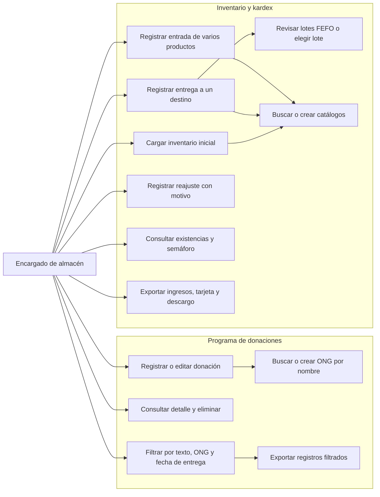
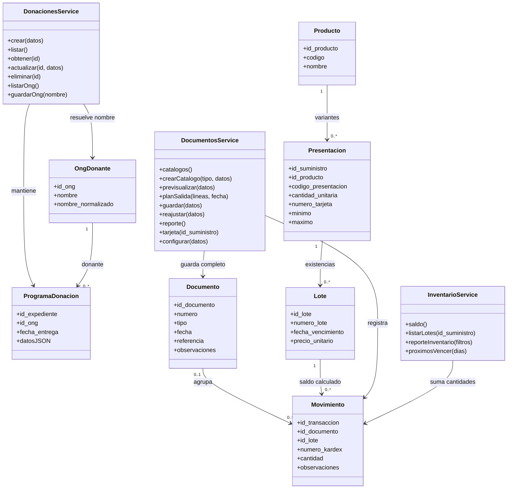
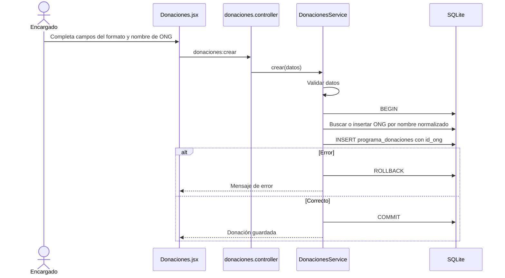
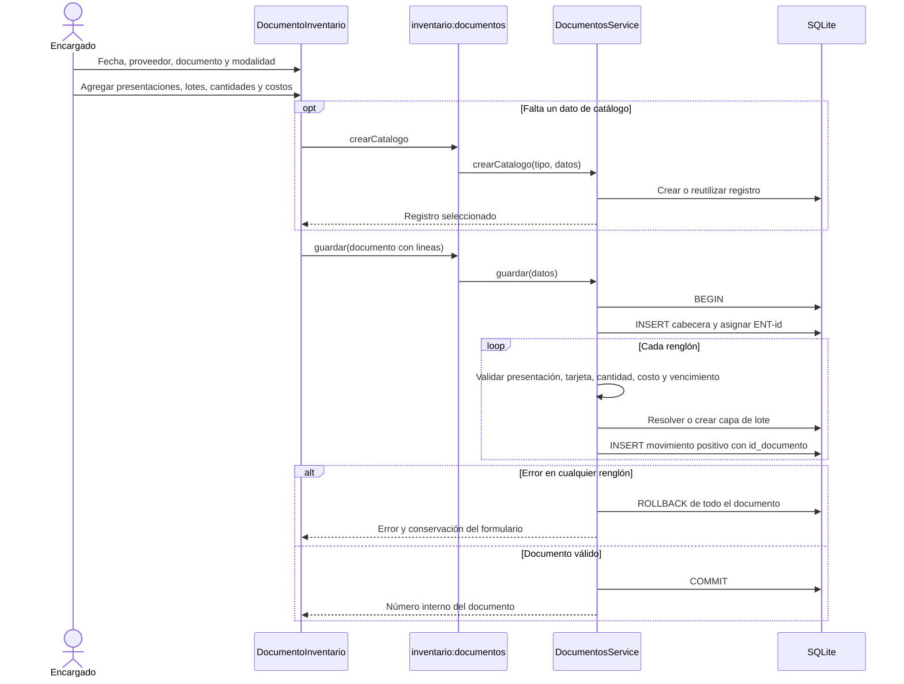
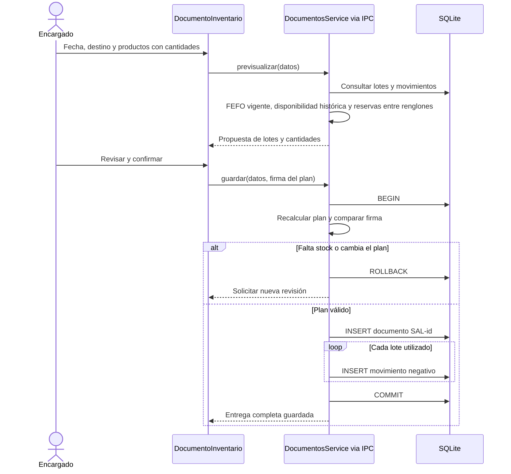
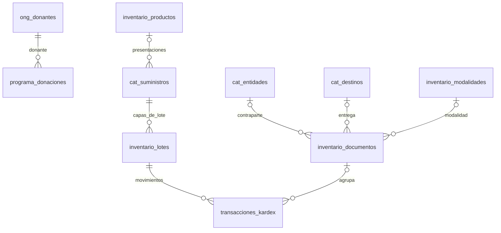

# Diagramas UML — Donaciones e inventario

Actor operativo: **Encargado de almacén**. Se muestra el flujo vigente de documentos
múltiples, independiente del programa de donaciones. Para el esquema físico,
incluidas columnas y relaciones legadas, ver [Base de datos](06-base-de-datos.md).

## 1. Casos de uso

No hay inclusión entre registrar una donación documental y registrar una entrada
de inventario. Son operaciones independientes.

## 2. Clases y servicios

Los registros anteriores pueden no tener producto o documento vinculado hasta
su migración/completado. El saldo de lote es derivado, no atributo persistido.
Una capa de lote representa además el costo de recepción.

## 3. Secuencia — Registrar donación

No participan servicios de inventario, lotes ni movimientos.

## 4. Secuencia — Entrada con varios productos

Crear catálogos es una operación independiente: esos registros permanecen aunque
se cancele o falle el documento posterior.

## 5. Secuencia — Salida con revisión de lotes

## 6. Casos de uso y resultados

| Caso | Resultado / regla |
|---|---|
| Registrar/editar donación | Solo programa de donaciones; ONG por nombre, monto calculado |
| Eliminar donación | Elimina el registro documental, conserva ONG e inventario |
| Filtrar donaciones | Texto + ONG con registros + fecha de entrega, no fecha de movimiento |
| Exportar donaciones | 29 columnas, incluido consecutivo y fecha de entrega, solo filas filtradas |
| Crear presentación | Código base + código de presentación; tarjeta y niveles; saldo independiente |
| Completar presentación anterior | Conserva ID e historial; no cambia contenido si tiene movimientos |
| Registrar entrada | Cabecera única y todos los productos en una transacción |
| Registrar salida | Destino único y varias presentaciones; revisión y revalidación de lotes |
| Cargar inicial | Documento INI con movimientos positivos de reajuste por lote |
| Reajustar | Cantidad entera no nula, lote existente y motivo obligatorio |
| Exportar tarjeta | Movimientos cronológicos, saldo anterior, saldo acumulado y valoración |
| Exportar descargo | Corte mensual y entregas agrupadas por distrito/otros |

## 7. Relaciones activas

La FK única de la tabla histórica `expedientes_donacion` a un movimiento se conserva
por compatibilidad, pero no forma parte de estas relaciones activas ni del nuevo CRUD.

## 8. Reglas transversales

- Cantidades de entrada/salida enteras positivas; reajustes enteros distintos de cero.
- Costos no negativos; totales calculados según presentación y capa de costo.
- Tarjeta por presentación, número interno por documento y referencia externa separados.
- Selección automática por vencimiento (**FEFO**), con opción de lote específico.
- Validación de stock entre renglones y en fechas retroactivas.
- Sin conversión automática entre presentaciones.
- Sin efectos cruzados entre donaciones documentales e inventario.
- Donantes con solo nombre; sin NIT, contacto ni campos adicionales.
