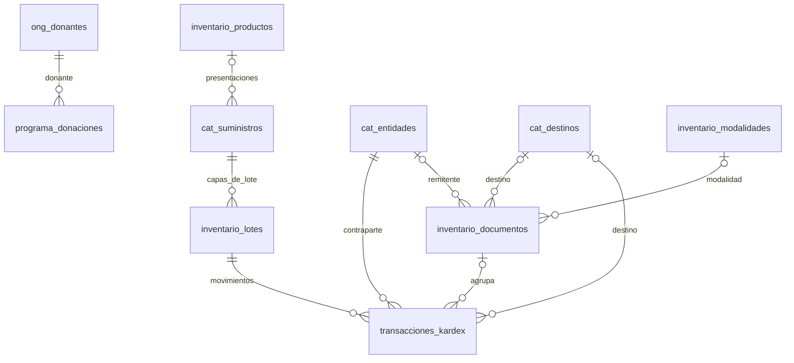

# Base de datos — Donaciones e inventario

## 1. Motor y fuentes del esquema

- SQLite mediante `better-sqlite3`; archivo `database.sqlite` en
  `app.getPath('userData')`.
- Conexión: WAL, claves foráneas activas, `synchronous = NORMAL`.
- Esquema general: `src/main/database/schema.js`.
- Ampliaciones de inventario: `src/main/modules/kardex/documentos.schema.js`.
- Las operaciones compuestas usan `db.transaction()`; no se presupone un bloqueo
  exclusivo permanente de la base.
- Los identificadores descritos como PK son enteros autoincrementales, salvo
  claves de configuración y sesión.

## 2. Modelo activo



Las relaciones opcionales de producto/documento admiten registros anteriores.
**No existe una FK entre el programa de donaciones y el inventario.**

## 3. Donaciones

### `ong_donantes`

| Columna | Tipo / restricción |
|---|---|
| `id_ong` | INTEGER PK |
| `nombre` | TEXT NOT NULL; único dato de negocio solicitado |
| `nombre_normalizado` | TEXT NOT NULL UNIQUE; clave técnica sin acentos, con espacios normalizados y minúsculas |

No guarda NIT, dirección, teléfono o contacto. No reutiliza `cat_entidades`.

### `programa_donaciones`

| Columna | Tipo / restricción |
|---|---|
| `id_expediente` | INTEGER PK |
| `id_expediente_origen` | INTEGER UNIQUE nullable; metadato legado, sin FK |
| `id_ong` | INTEGER NOT NULL FK → `ong_donantes`; DELETE RESTRICT |
| `fecha_entrega` | DATE nullable; campo indexado para entrega de la donación |
| `datos` | TEXT NOT NULL; JSON con los campos documentales validados |

El JSON usa las claves de `src/shared/donaciones.js`; contiene año, expediente,
tipo, descripción, cantidad, precio y los datos documentales UCNI/SIAD/cartas/actas/
acuerdos/SIGES/SICOIN/CUR. El nombre de ONG también puede figurar en el JSON, pero
la consulta devuelve el nombre canónico desde la FK. `fecha_entrega` se mantiene
en la columna además del payload. El monto total se calcula, no se persiste como
importe independiente. `No.` es un consecutivo de vista/exportación.

Índices: `idx_programa_donante(id_ong)` e `idx_programa_entrega(fecha_entrega)`.
La lista completa de campos está en [Flujo de donaciones](flujo-donaciones.md).

## 4. Productos y presentaciones

### `inventario_productos`

| Columna | Tipo / restricción |
|---|---|
| `id_producto` | INTEGER PK |
| `codigo` | TEXT NOT NULL UNIQUE; código base del producto |
| `nombre` | TEXT NOT NULL; nombre/descripción/concentración |

### `cat_suministros`

Representa cada presentación controlada en inventario; conserva el identificador
utilizado por lotes y movimientos anteriores.

| Columna | Tipo / restricción |
|---|---|
| `id_suministro` | INTEGER PK |
| `codigo_producto` | VARCHAR(50) UNIQUE NOT NULL; código visible legado o compuesto `base/presentación` |
| `descripcion_completa` | TEXT NOT NULL |
| `cantidad_unitaria` | VARCHAR(100) NOT NULL; presentación/contenido, por ejemplo caja de 50 |
| `id_producto` | INTEGER FK → `inventario_productos`; nullable para compatibilidad |
| `codigo_presentacion` | TEXT nullable; no se inventa al migrar |
| `numero_tarjeta` | TEXT nullable; identifica la tarjeta de esta presentación |
| `minimo`, `maximo` | INTEGER nullable; niveles de seguridad |

Índice único parcial `idx_presentacion_producto(id_producto, codigo_presentacion)`
cuando `codigo_presentacion IS NOT NULL`. La unicidad de tarjeta entre
presentaciones se valida en el servicio; no hay índice UNIQUE para esa columna.
Los códigos se tratan como texto para conservar ceros iniciales.

El costo no pertenece al catálogo de suministros: está en la capa de lote.
Las existencias de distintas presentaciones no se convierten automáticamente.
Una presentación con movimientos no puede cambiar de contenido desde el nuevo flujo.

## 5. Contrapartes, destinos y modalidades

### `cat_entidades`

`id_entidad` PK, `nit_entidad` VARCHAR(20) nullable,
`nombre_razon_social` VARCHAR(200) NOT NULL y `tipo_entidad` TEXT NOT NULL con
CHECK `Proveedor`, `ONG` o `Distrito_Salud`.

Se utiliza en inventario, no como catálogo del programa de donaciones. El nuevo
flujo reutiliza proveedores por NIT o nombre normalizado. Para salidas, iniciales
y reajustes resuelve contrapartes internas compatibles con la FK obligatoria de
movimientos; el usuario no tiene que seleccionarlas adicionalmente.

### `cat_destinos`

`id_destino` PK, `nombre_destino` VARCHAR(200) NOT NULL UNIQUE y
`columna_descargo` TEXT nullable. La columna identifica el distrito del reporte o
`OTROS`; el movimiento conserva también el nombre de destino.

Se precargan los 19 destinos del Excel y `OTROS`, reutilizando coincidencias de
nombre normalizado. Destinos nuevos se clasifican en Otros en el flujo actual.

### `inventario_modalidades`

`id_modalidad` PK, `nombre` TEXT NOT NULL y `clave` TEXT NOT NULL UNIQUE.
Se normaliza la clave para reutilizar modalidades escritas con variantes de nombre.

## 6. Documentos y movimientos

### `inventario_documentos`

| Columna | Tipo / restricción |
|---|---|
| `id_documento` | INTEGER PK |
| `numero` | TEXT UNIQUE; asignado al guardar |
| `tipo` | TEXT NOT NULL; validado por el servicio |
| `fecha` | DATE NOT NULL |
| `id_entidad` | INTEGER nullable FK → `cat_entidades` |
| `id_destino` | INTEGER nullable FK → `cat_destinos` |
| `referencia` | TEXT nullable; factura, traslado o documento externo |
| `id_modalidad` | INTEGER nullable FK → `inventario_modalidades` |
| `observaciones` | TEXT nullable |

Tipos de documento: `Entrada_Compra`, `Entrada_Donacion`, `Salida`, `Inicial` y
`Reajuste`. Se validan en los servicios, no mediante CHECK en esta tabla.
Los números internos usan `ENT-`, `SAL-`, `INI-` y `AJU-` más el ID con seis dígitos.

**No hay tabla adicional de renglones de documento.** Los detalles se materializan
en movimientos relacionados por `id_documento`; si una salida se reparte entre
dos lotes produce dos movimientos. No hay identificador persistido del renglón UI.

### `inventario_lotes`

| Columna | Tipo / restricción |
|---|---|
| `id_lote` | INTEGER PK |
| `id_suministro` | INTEGER NOT NULL FK → `cat_suministros`; DELETE RESTRICT |
| `numero_lote` | VARCHAR(50) NOT NULL |
| `fecha_vencimiento` | DATE NOT NULL |
| `precio_unitario` | DECIMAL(10,2) NOT NULL |
| `ultimo_estado` | VARCHAR(10) nullable; estado del semáforo registrado |

El saldo no es columna física; tampoco existe `cantidad_inicial` en esta tabla.
Un lote recibido con distinto costo tiene capas con IDs diferentes, conservando
la valoración anterior. El servicio comprueba la consistencia de vencimiento
cuando se reutiliza el número de lote de una presentación.

### `transacciones_kardex`

| Columna | Tipo / restricción |
|---|---|
| `id_transaccion` | INTEGER PK |
| `numero_kardex` | VARCHAR(50) NOT NULL; **no es UNIQUE** |
| `id_entidad` | INTEGER NOT NULL FK → `cat_entidades`; DELETE RESTRICT |
| `id_lote` | INTEGER NOT NULL FK → `inventario_lotes`; DELETE RESTRICT |
| `fecha_movimiento` | DATETIME NOT NULL DEFAULT CURRENT_TIMESTAMP |
| `tipo_movimiento` | TEXT NOT NULL; CHECK entrada compra/donación, salida o reajuste |
| `cantidad` | INTEGER NOT NULL; signo según operación |
| `documento_referencia` | VARCHAR(100) nullable |
| `destino` | VARCHAR(200) nullable; nombre conservado para reportes |
| `id_destino` | INTEGER nullable; columna legada **sin FK declarada** |
| `id_documento` | INTEGER nullable FK → `inventario_documentos` |
| `observaciones` | TEXT nullable; detalle por producto o motivo del reajuste |

En documentos nuevos `numero_kardex` contiene la tarjeta de la presentación y puede
repetirse. Los movimientos anteriores pueden conservar números individuales `K-####`.
Los documentos iniciales se representan como movimientos positivos `Reajuste`.

Índices de consulta sobre lote, entidad, destino, suministro, vencimiento y documento.

## 7. Saldos y valoración

```text
Saldo por capa de lote = SUM(cantidad de sus movimientos)
Saldo por presentación = SUM(cantidad de todos sus lotes)
Valor de una capa = saldo de la capa × precio unitario
Descargo: saldo final = saldo inicial + ingresos − salidas
```

La tarjeta calcula saldo y valor acumulados en orden cronológico. El descargo
obtiene el saldo anterior al mes y los movimientos del periodo; los positivos
se acumulan como ingresos y los negativos como salidas por destino, incluido
Otros para correcciones sin destino. El precio por presentación se pondera por
los saldos al corte; si no hay saldo positivo se usa el promedio conocido al corte.

FEFO propone lotes vigentes por vencimiento ascendente. La planificación reserva
cantidades entre renglones y verifica disponibilidad histórica. La confirmación
recalcula y compara el plan antes de insertar movimientos negativos.

## 8. Configuración, tablas auxiliares y legado

- `configuracion(clave TEXT PRIMARY KEY, valor TEXT)`: opciones generales y JSON
  `tarjeta_inventario` con institución, unidad, dirección, teléfono, U.E., municipio,
  distrito y servicio. Los valores iniciales se basan en los formatos entregados.
- `usuarios` y `sesiones`: tablas de autenticación, fuera del detalle de estos módulos.
- `expedientes_donacion`: **tabla legada**, conservada con su FK única a
  `transacciones_kardex`. No la usa el CRUD actual de donaciones ni se crean
  registros allí desde las nuevas entradas de inventario.

La relación histórica de `expedientes_donacion` no debe interpretarse como una
dependencia del modelo activo `programa_donaciones`.

## 9. Migraciones

1. Se crean tablas y se agregan columnas faltantes de forma idempotente.
2. En bases donde `programa_donaciones` todavía usa `id_entidad`, se copian los
   nombres utilizados a `ong_donantes` y se reconstruye la tabla con `id_ong`,
   conservando IDs, fecha y payload y quitando `id_entidad` del JSON.
3. Los suministros anteriores se vinculan a productos sin cambiar sus IDs ni
   inventar códigos de presentación o tarjeta. También se vinculan suministros
   legados nuevos al consultar los catálogos.
4. Se agregan las referencias de documento y observaciones a los movimientos
   existentes; los anteriores pueden permanecer con `id_documento` vacío.
5. Se inicializan destinos y encabezados sin sobrescribir configuraciones existentes.

No hay importación automática recurrente desde `expedientes_donacion` al programa
de donaciones. Tampoco se convierte un expediente en una entrada de inventario.

Verificación: `node scripts/verificar-documentos.mjs` (Node >= 22.13, SQLite en memoria).
